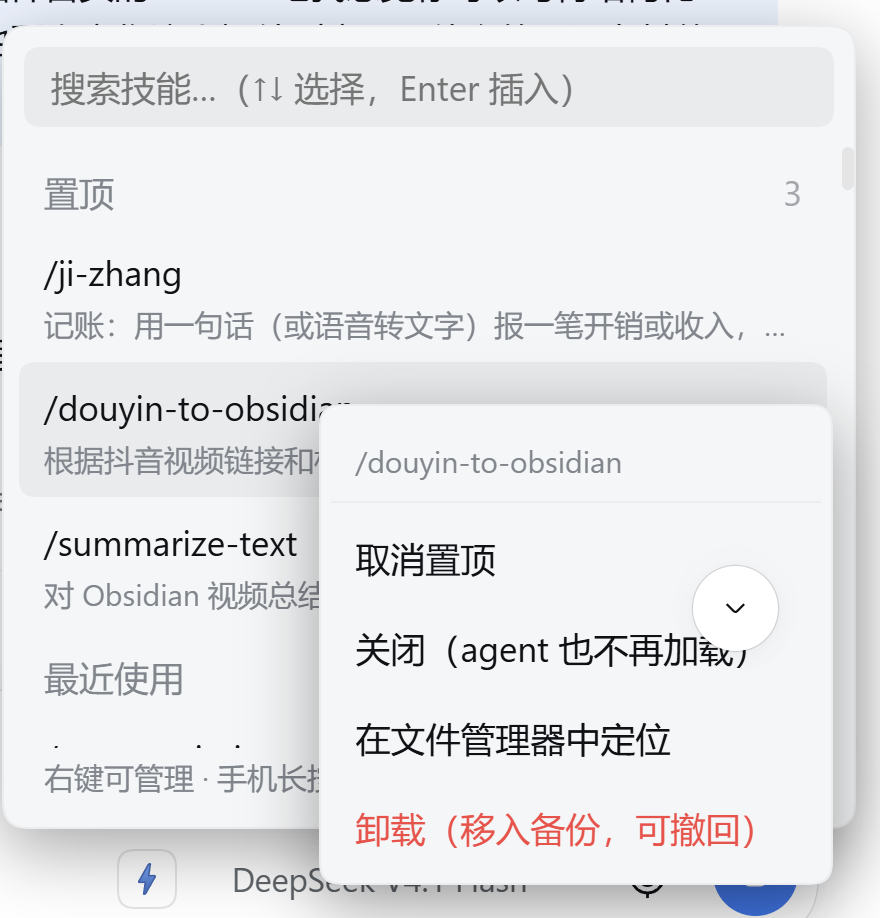

# dsh-skill-picker

[](https://www.npmjs.com/package/dsh-skill-picker)
[](https://github.com/a735624258/dsh-skill-picker/blob/main/LICENSE)

> **Добавляет кнопку ⚡ к полю ввода DSH: нажмёшь — увидишь все установленные навыки (с описаниями), найдёшь и кликнешь — `/имя-навыка` попадает в поле ввода, а DSH сам загрузит и выполнит этот навык.**

**Русский** — выбор навыка для веб-интерфейса DSH. Кнопка ⚡ в композере перечисляет все установленные навыки с их описаниями; выбор вставляет официальный жест `/имя-навыка` в черновик, поэтому DSH загружает этот навык вместе с твоим сообщением.

| | |
|---|---|
| Текущая версия | v0.5.28 |
| Лицензия | MIT |
| Платформа | DSH веб / десктоп (Electron) / мобильный браузер |
| Ядро | DSH `0.1.x` и `0.2.x` (см. [4.4](#44-совместимость-и-примечания)) |

---

## 1. Зачем это нужно

DSH и так понимает жест `/имя-навыка` — если в сообщении написать `/ji-zhang обед 12 юаней`, он автоматически загрузит навык «учёт расходов» и выполнит его. **Официально есть только дополнение по `/`, и оно опирается на две вещи:**

1. **Совпадение по префиксу** — нужно правильно ввести первые буквы имени навыка
2. **Твоя память** — установлено пятьдесят-шестьдесят навыков, кто запомнит, как каждый называется

Самый частый сценарий: навык «резервная копия памяти» установлен, но вспомнить, что он называется `backup-memory`, не получается — не нашёл и бросил.

## 2. Что он делает



1. **Видно** — рядом с полем ввода кнопка ⚡; нажмёшь — все навыки + полные описания
2. **Находится** — ищет по китайскому, пиньиню (`jiyi` / `ji yi` / `jy`) и английскому, сразу по имени и описанию
3. **Выбирается быстро** — недавно использованные сверху, можно закрепить вручную, `↑↓` + `Enter` — всё с клавиатуры
4. **Управляется** — правый клик (на телефоне — долгое нажатие): закрепить / отключить / открыть в файловом менеджере / убрать (в резерв, можно отменить)
5. **Везде одинаково** — закреплённые и недавние используются общие между десктопом, вебом и телефоном

**Не конфликтует с официальным дополнением `/` — можно пользоваться обоими:** помнишь имя — используй официальное, не помнишь — используй это.

## 3. Как пользоваться

1. Посмотри в правый нижний угол поля ввода (рядом с выбором модели), нажми **⚡**
2. Введи ключевые слова (китайский / пиньинь / английский) — список фильтруется на лету; можно просто листать `↑↓`
3. Кликни навык (или нажми `Enter`) — в поле ввода появится `/имя-навыка `, **курсор остаётся в конце**
4. Допиши сообщение и отправь Enter — DSH автоматически загрузит этот навык

Пример: нажми ⚡ → введи `jiyi` → кликни `/ji-zhang` → напиши «обед сегодня 12 юаней» → отправь.

| Действие | Результат |
|---|---|
| Нажать ⚡ | Открыть панель навыков |
| `↑` `↓` / `Enter` / `Esc` | Выбрать / вставить / закрыть |
| Правый клик по строке навыка (на телефоне — удержание 500 мс) | Меню: закрепить / отключить / открыть / убрать |
| В правом нижнем углу «Отключено N» | Посмотреть и вернуть отключённые навыки |
| Ввести `/` в поле ввода | Официальное меню слэша (этот плагин тоже улучшает его поиск и сортировку) |

## 4. Установка

### 4.1 Три пути — выбери нужный

1. **Нужна свежая версия** — установка прямо с GitHub (git-зависимость берёт последний commit, не зависит от 24-часового ограничения npm)
   ```sh
   dsh plugin --profile web add "git+ssh://git@github.com:a735624258/dsh-skill-picker.git"
   ```
2. **Нужна официальная версия npm** — сначала проверь номер версии, затем ставь по номеру (**не по голому имени**)
   ```sh
   npm view dsh-skill-picker version                      # например 0.5.28
   dsh plugin --profile web add dsh-skill-picker@0.5.28
   ```
3. **Нужно менять код** — склонируй и ставь в режиме link
   ```sh
   git clone https://github.com/a735624258/dsh-skill-picker.git
   dsh plugin --profile web add link:/path/to/dsh-skill-picker
   ```

> ⚠️ Установка по голому имени (`add dsh-skill-picker`) в течение **24 часов** после выхода новой версии будет заблокирована ограничением pnpm `minimumReleaseAge` и **автоматически откатится на старую версию**. Следуй трём путям выше — и не ошибёшься.

### 4.2 После установки нужен перезапуск

Маршруты host-части загружаются **при старте процесса**; просто открыть новую вкладку недостаточно:

| Что используешь | Как перезапустить |
|---|---|
| Веб-интерфейс | Перезапусти процесс `dsh web`, при необходимости жёстко обнови `Ctrl+F5` |
| Десктоп | Перезапусти процесс `DeepSeek Harness.exe` |

### 4.3 Сеть и удаление

1. Если HTTPS медленный или недоступен — используй SSH: `git clone git@github.com:a735624258/dsh-skill-picker.git`
2. Чтобы pnpm всегда ходил по SSH: `git config --global url."git@github.com:".insteadOf "https://github.com/"`
3. Если `dsh` блокируется политикой выполнения PowerShell → `powershell -ExecutionPolicy Bypass -Command "dsh plugin --profile web add link:C:\path\to\dsh-skill-picker"`
4. Удаление: `dsh plugin --profile web remove dsh-skill-picker`

### 4.4 Совместимость и примечания

| Версия ядра | Статус |
|---|---|
| `0.1.0-rc.6` ~ `0.1.x` | Поддерживается |
| `0.2.0-rc.1` / `rc.2` и `0.2.x` | Поддерживается (основная, проверено) |
| `1.0.0` и выше | Требует перепроверки |

1. **Широкий диапазон peer — намеренно** — `^0.1.0-rc.6 || >=0.2.0-rc.1 <1.0.0-0`. Пакеты ядра идут в ногу с версией ядра; жёсткая привязка к одной минорной линии приведёт к **ошибочному отклонению** плагина при обновлении ядра (в логе `skipping profile bundle`, внешне — кнопка ⚡ просто исчезает)
2. **Какие папки читаются** — проектные `<рабочая_папка>/.dsh/skills`, `<рабочая_папка>/.agents/skills`; пользовательские `~/.dsh/skills`, `~/.agents/skills` (`$DSH_AGENTS_HOME` переопределяет); при совпадении имён приоритет у проектного уровня
3. **Символические ссылки / Junction** у навыков читаются как есть; навыки с `user-invocable: false` не перечисляются (даже если перечислятся — официально молча пропускаются)
4. **На десктопе не нужна никакая ручная обработка** (с v0.5.15): не важно, лежит ли официальный UI навыков внутри `app.asar` или как обычная папка
5. **На телефоне нужна пара** — патч «не перехватывать фокус при смене сессии» от `dsh-pocket` и «карточка-исключение» `window.__dshSkillPickerFocusing` этого плагина — это пара; установишь только одну сторону — получишь «смену сессии с перехватом фокуса» или «курсор не возвращается после вставки навыка»
6. **Пока не поддерживаются** пользовательские папки навыков (официальные `customSkillDirs`) — приветствуются PR

## 5. Как это работает

```
[Клиент]  Кнопка ⚡ рядом с полем ввода
            ↓ получить список навыков (сначала официальный skills API, при сбое — сканирование хостом)
[Хост]    Папка навыков → имя + описание
            ↓ ты выбираешь
[Клиент]  Добавить "/имя-навыка " в поле ввода
            ↓ отправка
[DSH]     agent/pre-step распознаёт жест /имя-навыка → загружает навык → выполняет
```

**Этот плагин добавляет только слой UI**; загрузка и выполнение идут через официальный механизм DSH (`dsh-tool-skill` сканирует `/kebab-case-name` в сообщении пользователя), не трогает agent и не меняет официальный код.

1. **Список двумя путями** — сначала официальный skills API хоста (`remote.skills.list`, тот же источник, что у официального `/`-дополнения, автоматически включает пользовательский и проектный уровни), при недоступности — маршрут сканирования хостом
2. **Нечёткий поиск + пиньинь в меню `/`** (с v0.5.15) — перехват официального источника в рантайме, **ни один файл не меняется**. Причина: официально нельзя зарегистрировать одноимённый источник `/` (дубликат сразу даёт ошибку), а изменение официальных файлов при `app.asar` / жёстких ссылках pnpm / висячих симлинках молча не срабатывает
3. **У маршрута управления навыками три проверки** — обязательный пользовательский заголовок `x-dsh-skill-picker: 1`; клиент сообщает только имя навыка, путь хост ищет сам; путь обязан лежать ровно на один уровень ниже известного корня навыков. **«Убрать» никогда не удаляет** — только переносит в `$DSH_HOME/skill-backups/`
4. **Ошибка не роняет всё** — при отсутствии слота молча пропускается, при сбое сканирования возвращается пустой список, при сбое синхронизации состояния — деградация до чисто локального

## 6. Разработка

```sh
npm install                                    # установить зависимости
npm run build                                  # src/ → lib/ (клиентский бандл обязан быть в формате __ModuleLoader__ handshake)
dsh plugin --profile web add link:$PWD         # установка в web-профиль в режиме link, изменение исходников действует сразу
node --test                                    # тесты
```

> ⚠️ После изменения исходников **обязательно `npm run build`**: `lib/client.js` — это артефакт сборки; ESM-исходники нельзя напрямую загрузить как клиентский бандл (web-оболочка DSH требует формат-рукопожатие `window.__ModuleLoader__.load({ id, factory })`), иначе при старте будет `loaded without registering "dsh-skill-picker"`.

```
dsh-skill-picker/
├── package.json            # dsh.bundle.patch + объявление dsh.client + таблица совместимости
├── cordis.patch.yml        # patch бандла: вставляет строку плагина в web-профиль
├── build.mjs               # esbuild-сборка: host ESM + client CJS
├── src/
│   ├── index.js            #   host: маршрут папки навыков + направляющий блок для agent
│   ├── skill-ops.js        #   host: отключить / включить / открыть / убрать / отменить
│   ├── patch-ui-skill.js   #   host: патч старого файла (по умолчанию выкл) + авто-восстановление
│   ├── dir-entry.js        #   чтение записи каталога (следование симлинкам / Junction)
│   └── client/
│       ├── index.jsx       #   client: панель ⚡ (поиск / группы / сортировка / контекстное меню)
│       ├── slash-source.js #   client: перехват меню `/` в рантайме
│       ├── shared-state.js #   client: общие между платформами закреплённые / недавние
│       └── session-view.js #   client: идентичность сессии и рабочая папка cwd
├── lib/                    # артефакты сборки (не редактировать вручную)
├── test/                   # тесты node --test (8 файлов)
└── docs/                   # скриншоты
```

Последний результат тестов: **88 случаев / 87 прошло / 1 пропущено / 0 падений** (пропущенный требует прав Windows на создание символической ссылки).

---

## Журнал изменений

Последние 3 версии:

- **v0.5.28** — недавно закреплённый навык ставится первым в группе «Закреплённые»
- **v0.5.27** — парная «карточка-исключение» для телефона «курсор не возвращается после вставки навыка»
- **v0.5.26** — панель ⚡ позволяет управлять навыками (контекстное меню) + 12 исправлений

Описание всех версий (краткий обзор + подробности 12 версий) см. в **[CHANGELOG.md](CHANGELOG.md)**.

---

MIT License · [LICENSE](LICENSE)
